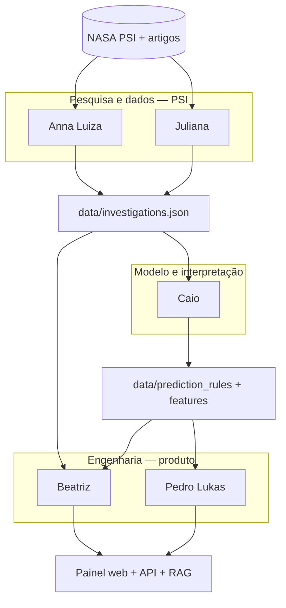

# Divisão de tarefas — Equipe Flame in Freefall

**Equipe:** Beatriz · Pedro Lukas · Anna Luiza · Caio · Juliana  

**Foco do desafio:** encontrar, **comparar** e **interpretar** dados PSI para fire safety — com camada de **previsão orientada por evidência** (não “chute” de IA).

**Documento irmão:** [PLANO.md](./PLANO.md)

---

## 1. Como o time se encaixa (três frentes)

| Frente | Pessoas | Pergunta que respondem |
|--------|---------|-------------------------|
| **Pesquisa & curadoria** | Anna Luiza, Juliana | *Quais dados são vitais? O que difere entre investigações? O que significa para tripulação e Terra?* |
| **Modelo & previsão** | Caio | *Dado um cenário (O₂, pressão, material, 0g), quais experimentos se aplicam e qual risco/ recomendação o PSI suporta?* |
| **Código & produto** | Beatriz, Pedro Lukas | *Como isso vira painel, comparador, chat e scenario builder utilizável no demo?* |

---

## 2. Papel de cada pessoa

### Anna Luiza — Curadoria PSI (prevenção, materiais, escala)

**Missão:** garantir que os experimentos **mais críticos para inflamabilidade e materiais** estejam bem documentados e comparáveis.

**Responsabilidades principais**

- Levantar e preencher fichas (objetivos, condições, variáveis que mudaram vs fixas):
  - **BASS / BASS-II**, **SPICE**, **SLICE**, **BRE**, **CFI-G**, **SAFFIRE I–II–III**
- Extrair **dados vitais** para previsão: % O₂, pressão, tipo de combustível/sólido, fluxo de ar, hardware (MSG/CIR/Cygnus).
- Redigir em português: “**Interpretação fire safety**” (3–5 bullets por investigação).
- Montar **matriz comparativa** (planilha ou markdown) entre BASS × SAFFIRE × CFI-G (escala, material, ambiente lunar).
- Preencher `earth_applications` quando houver (materiais, EPI, SAFFIRE).

**Entregáveis**

| Prazo | Entrega |
|-------|---------|
| H+6h | 6 investigações “herói” completas no JSON (lista acima, metade) |
| H+18h | Restante das heróis + tabela comparativa BASS/SAFFIRE/CFI-G |
| H+36h | Chunks RAG `interpretation` + `comparison_notes` para cada herói |

---

### Juliana — Curadoria PSI (detecção, supressão, Terra)

**Missão:** cobrir **detecção/supressão** e a ponte **espaço → Terra** com evidência PSI.

**Responsabilidades principais**

- Fichas completas:
  - **SAME**, **SAME-R**, **FLEX / FLEX-2**, **CFI**, trabalhos solo ligados a fumaça (ex. PSI-115 se aplicável), **DAFT** (hardware dual-use)
- Identificar **variáveis vitais** para detecção (tamanho de aerossol, duração de combustão, materiais de teste) e supressão (diluentes, pressão, gotículas).
- Redigir blocos **Impacto na Terra** + links Spinoff (detector, névoa fina, cilindros, vestuário).
- Montar rascunho de `data/earth_spinoffs.json` (4 cards fixos + PSI relacionados).
- Comparar **SAME vs SAME-R** (o que mudou no reflight).

**Entregáveis**

| Prazo | Entrega |
|-------|---------|
| H+6h | SAME, SAME-R, FLEX com campos vitais preenchidos |
| H+18h | `earth_spinoffs.json` + 4 fichas com `earth_applications` |
| H+36h | Narrativa Mission context (Apollo/Mir/Artemis) em markdown para a página |

---

### Caio — Modelo de previsão e cenários (evidência PSI)

**Missão:** dar **rumo ao modelo**: o que entra, o que sai, e como cada “previsão” cita investigações reais.

**Importante para o hackathon:** não treinar rede neural do zero. O MVP é **modelo híbrido**:

1. **Features estruturadas** vindas do JSON (curadoria).
2. **Score de similaridade / risco** (regras + pesos definidos com o time de pesquisa).
3. **Camada LLM** só para **explicar** o resultado com citações PSI (RAG).

**Responsabilidades principais**

- Escrever `docs/MODELO-PREVISAO.md` (especificação que Beatriz/Pedro implementam):
  - **Entradas:** `o2_percent`, `pressure_psi`, `gravity` (0g | 1g | partial_future), `material_class` (solid_fabric | liquid | gas | aerosol), `pillar` (prevention | detection | suppression), `environment` (ISS | lunar_habitat | rover).
  - **Saídas:** lista ranqueada de `psi_id`, `risk_band` (low | medium | high | insufficient_data), `confidence`, `rationale_bullets[]`.
  - **Regras v1:** ex. O₂ ≥ 30% e sólido → priorizar BASS, CFI-G, SAFFIRE; detecção → SAME; supressão → FLEX.
- Definir `data/prediction_weights.json` (pesos ajustáveis; documentar suposições).
- Validar **10 cenários de teste** (5 lunares, 3 ISS, 2 Terra) com Anna/Juliana — “academically defensible”.
- Preparar texto do **Scenario builder** para o pitch: *“não prevê fogo; prevê quais experimentos PSI melhor informam o risco”*.

**Entregáveis**

| Prazo | Entrega |
|-------|---------|
| H+8h | Esboço do modelo + lista de features obrigatórias no JSON |
| H+20h | `MODELO-PREVISAO.md` + `prediction_weights.json` + 10 cenários esperados |
| H+40h | Validação escrita cenário a cenário; ajuste de pesos com Anna/Juliana |

**Dependência:** não fechar pesos sem pelo menos **12 fichas** com `o2_range`, `material`, `pillar` preenchidos.

---

### Beatriz — Engenharia (coordenação, backend, dados, RAG)

**Missão:** integrar tudo no repositório, API e IA com citações; coordenar entregas e demo.

**Responsabilidades principais**

- Scaffold do projeto (`data/investigations.schema.json`, pastas, README).
- Pipeline: JSON curado → API → frontend.
- **RAG / chat “Ask PSI”** (chunks + prompt com escopo tripulado, sem propelentes).
- Implementar **endpoint de previsão** conforme spec do Caio (`/api/scenario` ou similar).
- Deploy, env vars, checklist Space Apps.
- Sincronização diária (o que bloqueia código).

**Entregáveis**

| Prazo | Entrega |
|-------|---------|
| H+4h | Repo + schema JSON + template de ficha vazio |
| H+24h | Explore + detail lendo JSON; ingestão de chunks |
| H+48h | RAG estável + scenario API + deploy |

---

### Pedro Lukas — Engenharia (frontend, UX, comparador, Earth)

**Missão:** painel que **mostra** comparação e interpretação — visual forte para jurados.

**Responsabilidades principais**

- UI (home, explore, filtros `earth_spinoff`, mission context).
- **Comparador** 2–3 investigações (tabela semelhanças/diferenças).
- Página **Earth & Spinoffs** consumindo `earth_spinoffs.json`.
- **Scenario builder** (formulário → chama API do Caio/Beatriz → mostra investigações + risco + explicação).
- Polimento visual, acessibilidade, roteiro de cliques para o vídeo.

**Entregáveis**

| Prazo | Entrega |
|-------|---------|
| H+8h | Layout + navegação + cards mock |
| H+28h | Comparador + fichas + filtros |
| H+48h | Earth hub + scenario UI + versão “demo mode” |

---

## 3. Lista conjunta: dados vitais (o que pesquisa precisa achar)

Tudo isso deve ir para o JSON — o modelo **não funciona** sem esses campos.

| Campo | Por que é vital | Quem prioriza |
|-------|-----------------|---------------|
| `psi_id`, `experiment_name`, `url` | Rastreabilidade | Todos |
| `fire_safety_pillar[]` | Prevenção/detecção/supressão | Anna + Juliana |
| `fuels[]`, `material_class` | Previsão de inflamabilidade | Anna |
| `o2_min`, `o2_max`, `pressure` | Cenário lunar / traje | Anna + Caio |
| `flow_rate_notes`, `gravity` | Microgravidade vs solo | Anna + Juliana |
| `hardware[]` | Comparador e narrativa | Anna + Juliana |
| `sensors[]`, `measured_variables[]` | Detecção / modelagem | Juliana |
| `variables_changed_vs_fixed` | **Comparar** investigações | Anna + Juliana |
| `interpretation_fire_safety` | Texto para UI e RAG | Anna + Juliana |
| `earth_applications` | Valor na Terra | Juliana |
| `prediction_tags[]` | Entrada do modelo (ex. `high_oxygen`, `smoke_aerosol`) | Caio define, pesquisa preenche |

**Meta mínima:** 12 investigações herói **100% preenchidas** nas linhas acima; stretch 25+.

---

## 4. Fluxo de trabalho (handoffs)

| Ordem | Quem | Ação | Para quem |
|-------|------|------|-----------|
| 1 | Anna + Juliana | Pesquisam PSI e preenchem template | JSON no repo |
| 2 | Caio | Lê JSON, define tags/pesos, cenários | Beatriz implementa |
| 3 | Beatriz | API + RAG + ingest chunks | Pedro consome na UI |
| 4 | Pedro | Telas comparador + scenario | Demo |
| 5 | Caio + Anna + Juliana | Testam 10 cenários na UI | Ajuste antes do pitch |
| 6 | Beatriz + Pedro | Vídeo e slides | Todos revisam fatos PSI |

**Contrato de arquivo:** mudanças em `data/investigations.json` via PR ou aviso no grupo; Beatriz faz merge no schema.

**Template de ficha:** copiar de `data/investigations.schema.json` (criar no repo) — uma investigação por PR/commit lógico.

---

## 5. Cronograma por pessoa (hackathon)

Horas relativas (H0 = início oficial do time).

| Hora | Anna Luiza | Juliana | Caio | Beatriz | Pedro Lukas |
|------|------------|---------|------|---------|-------------|
| 0–6h | 3 fichas prevenção/escala | SAME, FLEX, spinoffs rascunho | Features + doc esboço | Repo + schema | UI shell |
| 6–18h | Completar heróis + matriz BASS/SAFFIRE | Earth JSON + SAME-R/CFI | Pesos + 10 cenários | API + seed JSON | Explore + detail |
| 18–30h | Chunks interpretação | Mission context MD | Validar cenários | RAG | Comparador |
| 30–42h | Revisão fichas stretch | Revisão Terra | Ajuste pesos | Scenario API | Earth + scenario UI |
| 42–48h | QA científico pitch | QA spinoffs | Demo narrativa modelo | Deploy + vídeo técnico | Polish + roteiro demo |

---

## 6. Modelo de previsão — visão para o pitch (Caio + Beatriz)

**O que dizemos aos jurados**

> O painel **não substitui** simulação CFD nem teste de bancada. Ele **prevê qual conjunto de evidências PSI** melhor responde a um cenário habitável (O₂, pressão, material, gravidade) e classifica **risco relativo** com base em experimentos reais da ISS e correlatos.

**Três camadas (implementação MVP)**

1. **Matcher:** filtra investigações por tags e intervalos numéricos.
2. **Scorer:** soma pesos (`prediction_weights.json`) → `risk_band`.
3. **Explainer:** LLM/RAG gera parágrafo com **PSI-IDs** (obrigatório).

**Exemplo de cenário demo (lua)**

- Entrada: 32% O₂, 10 psi, tecido sólido, 0g, `lunar_habitat`.
- Saída esperada: alto vínculo BASS/SAFFIRE/CFI-G; `risk_band: high`; recomendação de leitura ordenada.

---

## 7. Rituais rápidos

- **Sync a cada 4h (15 min):** bloqueios, fichas novas, API quebrou?
- **Canal fixo:** “Ficha pronta” = checklist dos campos vitais (seção 3).
- **Dono do merge:** Beatriz (schema); **donos do conteúdo:** Anna/Juliana aprovam texto científico; Caio aprova tags de previsão.

---

## 8. Pitch e vídeo — quem fala o quê

| Trecho | Responsável |
|--------|-------------|
| Problema histórico (Apollo/Mir) | Juliana |
| Dados vitais e comparação BASS/SAFFIRE | Anna Luiza |
| Scenario / previsão com evidência PSI | Caio |
| Demo navegação + Earth | Pedro Lukas |
| Fechamento impacto dual + stack NASA | Beatriz |

---

## 9. Checklist antes de enviar

- [ ] 12+ fichas com dados vitais completos  
- [ ] 8+ com `earth_applications`  
- [ ] Comparador com 3 pares ensaiados (ex. SAME/SAME-R, BASS/SAFFIRE, FLEX/CFI)  
- [ ] 10 cenários do Caio passando na UI com PSI-IDs visíveis  
- [ ] 5 perguntas RAG estáveis (ver [PLANO.md](./PLANO.md) seção 8)  
- [ ] Vídeo com trilha espaço + trilha Terra  

---

## 10. Ajustes flexíveis

Se alguém tiver mais afinidade com código:

- Pedro pode pegar mais backend e Beatriz mais front (ou vice-versa) — manter **um dono de RAG** e **um dono de UI**.
- Se Caio estiver atolado na validação, Anna ajuda em `prediction_tags`; Juliana valida cenários de detecção.

---

*Atualizar este documento quando o time decidir stack definitiva (Next vs FastAPI) ou redistribuir fichas PSI.*