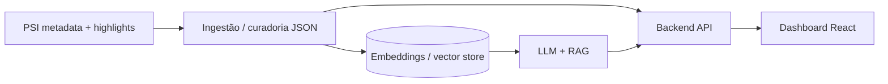

# Flame in Freefall — Plano do projeto (NASA Space Apps 2026)

**Desafio:** *Flame in Freefall: AI-Powered Fire Safety Insights from Microgravity Combustion Data*

**Proposta em uma frase:** Um painel web que cataloga investigações de combustão no [PSI](https://psi.nasa.gov/physci/repo/search?q=combustion), classifica cada uma por prevenção / detecção / supressão e por ambiente (ISS, base lunar, veículo pressurizado), conecta cada descoberta a **benefícios concretos na Terra** (detecção de fumaça, extintores, equipamento de bombeiros), e usa IA (RAG + resumos) para responder perguntas do tipo: *“O que o PSI diz sobre 30% O₂ em microgravidade e tecidos?”* — e *“Qual pesquisa SAME respalda detectores que distinguem fumaça de poeira?”*

---

## 1. Visão da solução

**Nome sugerido:** *Flame in Freefall — PSI Fire Safety Intelligence*

**Diferencial frente a “só buscar no PSI”:**

- Camada de **relevância para segurança contra incêndio** (não só “combustion science”).
- **Comparativo** entre investigações (hardware, combustível, O₂, sensores).
- **Insights acionáveis** (modelagem, materiais, equipamentos).
- **Ponte espaço → Terra:** cada experimento relevante ligado a spin-offs, setores e casos de uso terrestres (não é apêndice decorativo — é critério de curadoria).

**Impacto dual (argumento para jurados):** a NASA financia combustão em microgravidade também porque o ambiente isolado revela física que melhora **prevenção, detecção e supressão no planeta**. O painel torna esse retorno visível junto com Artemis e habitats lunares.

### Recursos NASA (referência)

| Recurso | URL |
|--------|-----|
| Repositório PSI — Combustion | https://psi.nasa.gov/physci/repo/search?q=combustion |
| NASA Combustion Science | https://www.nasa.gov/glenn/glenn-expertise-space-exploration/physical-sciences-program/combustion-science/ |
| ScienceCast (vídeo ISS) | https://www.youtube.com/watch?v=W1oXykoz9zg |
| Apollo 1 | https://sma.nasa.gov/sma-disciplines/accllp/apollo-1 |
| Apollo 13 | https://sma.nasa.gov/sma-disciplines/accllp/apollo-13 |
| Incêndio na Mir (1997) | https://www.nasa.gov/history/25-years-ago-fire-aboard-space-station-mir/ |
| Spinoff — cilindros bombeiros | https://spinoff.nasa.gov/node/9582 |
| Spinoff — detector de incêndio | https://spinoff.nasa.gov/node/9407 |
| Spinoff — vestuário bombeiros | https://spinoff.nasa.gov/node/9918 |

---

## 2. Público e jornadas

| Persona | Jornada no painel | “Momento uau” no pitch |
|--------|-------------------|-------------------------|
| Engenheiro de fire safety | Filtrar por ambiente lunar + prevenção | Ver SAFFIRE/BASS/CFI-G lado a lado |
| Pesquisador / pós | Explorar variáveis experimentais e baixar contexto | Matriz “investigação × atributo” |
| Professor / graduação | Sumário didático + links NASA | Chama esférica + ligação com SAME/detecção |
| Jurado NASA | Impacto Artemis / Marte + dados reais PSI | Query em linguagem natural com citação PSI-ID |
| Indústria / bombeiros / HSE | Filtrar por `earth_spinoff` ou setor (mineração, edifícios) | SAME → detector com menos falso alarme; névoa fina da ISS → supressão terrestre |
| Professor | Aula “do laboratório orbital ao cotidiano” | Mapa PSI → Spinoff NASA com links |

---

## 3. Aplicações na Terra (eixo de valor)

O desafio sugere explicitamente mostrar como dados PSI de fire safety **beneficiam a Terra**. Tratar isso como **requisito de produto**, não só uma página bonita.

### 3.0 Por que incluir

- Demonstra **relevância social** além da exploração espacial.
- Conecta experimentos “difíceis de ler” a **produtos e normas** que pessoas conhecem (alarmes, extintores, EPI).
- Diferencia o projeto de um catálogo PSI genérico: **“o que isso muda na Terra?”** em cada ficha.

### 3.0.1 Linhas de transferência (curadoria)

| Tema fire safety (PSI) | Pesquisa / hardware de referência | Benefício na Terra (exemplos do enunciado / Spinoffs) |
|------------------------|-----------------------------------|------------------------------------------------------|
| **Detecção de fumaça e aerossóis** | SAME, SAME-R | Detector do Shuttle que **discrimina fumaça vs poeira** → menos alarmes falsos (mineração, indústria) — [Spinoff detector](https://spinoff.nasa.gov/node/9407) |
| **Supressão** | FLEX, FLEX-2, CFI | **Extintores de névoa fina de água** desenvolvidos para a ISS com uso prático terrestre |
| **Materiais e EPI** | SAFFIRE, BASS (tecidos, plásticos) | **Roupas e cilindros de ar** para bombeiros derivados de tecnologia de trajes espaciais — [cilindros](https://spinoff.nasa.gov/node/9582), [vestuário](https://spinoff.nasa.gov/node/9918) |
| **Modelagem de fumaça** | PSI-115 e trabalhos ligados a SAME | Simulações de geração de fumaça em 0g vs 1g → projetos de detecção e ventilação terrestres |
| **Instrumentação reutilizada** | DAFT / DAFT-2 (hardware SAME) | Mesmo sensor em contextos diferentes: fumaça (incêndio) vs poeira (qualidade do ar) — mostra versatilidade do ecossistema PSI |

### 3.0.2 Funcionalidades no painel (MVP)

1. **Tag obrigatória quando aplicável:** `earth_spinoff` + campo `earth_sectors[]` (ex.: `mining`, `aviation`, `buildings`, `first_responders`, `manufacturing`).
2. **Bloco em cada ficha:** “**Impacto na Terra**” — 2–4 frases + links Spinoff NASA / NASA History quando existir (mesmo sem spin-off oficial, descrever *transferência conceitual*: ex. “dados de tamanho de aerossol em 0g informam algoritmos de detecção”).
3. **Página / aba Earth & Spinoffs:**
   - Cards por categoria (Detecção · Supressão · EPI · Materiais).
   - **Mapa bidirecional:** clique em “Detector fumaça/poeira” → SAME/SAME-R + trechos PSI + Spinoff.
   - Contador na home: “**N investigações com aplicação terrestre documentada**”.
4. **Filtro global na Explore:** “Mostrar só com benefício na Terra”.
5. **RAG:** prompts e chunks incluem seção `earth_transfer`; respostas podem cruzar espaço + Terra com citações.

### 3.0.3 Dados (`investigations.json`)

Além dos campos já planejados, incluir:

```json
"earth_applications": {
  "summary_pt": "string",
  "sectors": ["first_responders", "mining"],
  "spinoff_urls": ["https://spinoff.nasa.gov/node/9407"],
  "related_psi_ids": ["PSI-102"],
  "transfer_type": "direct_spinoff | conceptual | dual_use_hardware"
}
```

### 3.0.4 Pitch e demo (Terra)

- **Slide dedicado:** “Do MSG à mina: como SAME mudou detecção de fumaça”.
- **Cena no vídeo (20–30 s):** filtro `earth_spinoff` → ficha SAME → link Spinoff → pergunta ao chat: *“Como os dados de aerossol em microgravidade reduzem falso alarme na Terra?”*
- **Frase de fechamento sugerida:** *“Artemis precisa de fogo sob controle na Lua; a mesma ciência já protege operações e bombeiros na Terra.”*

---

## 4. Escopo para hackathon

### 4.1 MVP (obrigatório para nota alta)

1. **Catálogo curado** (~25–40 investigações), foco fire safety:
   - **Prevenção:** BASS, BASS-II, SPICE, SLICE, BRE, CFI-G (O₂ alto), partes de ACME relevantes
   - **Detecção:** SAME, SAME-R (mencionar DAFT como outro uso do hardware)
   - **Supressão:** FLEX, FLEX-2, CFI (gotículas / diluição CO₂/He)
   - **Escala / cenário tripulado:** SAFFIRE-I, SAFFIRE-II, SAFFIRE-III

2. **Ficha por investigação** (metadata estruturada):
   - Objetivos, abordagem, tipo (microgravidade / solo), hardware (CIR/MDCA, MSG, Cygnus…)
   - Combustível e geometria da amostra
   - Condições: % O₂, pressão, fluxo de ar, gravidade (0g; nota sobre LUCI/FM2 futuro)
   - Sensores / medições
   - **Tags fire safety:** `prevention` | `detection` | `suppression`
   - **Tags ambiente:** `ISS`, `lunar_habitat`, `pressurized_rover`, `earth_spinoff`
   - **`earth_applications`** (resumo, setores, spin-offs, tipo de transferência) — ver seção 3.0.3
   - Link direto para PSI (ex.: PSI-98 SAFFIRE-I)

3. **Página “Mission context”** (1 tela):
   - Apollo 1, Apollo 13, Mir, Artemis II (alarme de fumaça) — narrativa + lição aprendida
   - Trajes (4,3 psi, O₂ puro) vs base lunar (~30% O₂, ≤10,2 psi) → por que CFI-G e BASS importam

4. **Assistente IA (RAG):**
   - Respostas **sempre com referência** (PSI-ID, nome do experimento)
   - Escopo: ambientes habitáveis tripulados; **excluir** propelentes/foguete (conforme enunciado)
   - 5–10 perguntas de demo pré-testadas (ver seção 8)

5. **Comparador simples:**
   - Escolher 2–3 investigações → tabela de semelhanças/diferenças (variáveis que mudaram vs fixas)

6. **Aplicações na Terra (MVP):**
   - Página Earth & Spinoffs completa (seção 3.0.2)
   - Pelo menos **8 investigações** com `earth_applications` preenchido (prioridade: SAME, SAME-R, FLEX, SAFFIRE, BASS)
   - Home destaca impacto dual espaço/Terra

### 4.2 Stretch (se sobrar tempo)

- Visualizações: rede investigação ↔ hardware ↔ tema fire safety
- **Scenario builder:** O₂%, pressão, microgravidade → lista investigações + trechos PSI + recomendação da IA
- Export CSV/JSON para modelagem preditiva
- Linha do tempo visual “PSI → Spinoff → uso hoje”
- Comparador espaço vs Terra: mesma variável (ex. tamanho de partícula de fumaça) em SAME vs condições 1g citadas em trabalhos PSI solo
- Ingestão automática via API/crawl PSI; senão dataset JSON versionado no repo

### 4.3 Fora do MVP

- Treinar modelo preditivo de inflamabilidade do zero (PSI como **fonte para modelagem futura**)
- Gravidade parcial com dados reais (apenas **roadmap LUCI/FM2** + E-FIELD como limite conceitual)

---

## 5. Arquitetura recomendada



### Stack pragmática

| Camada | Opção A (rápida) | Opção B (Python) |
|--------|------------------|------------------|
| Front | Next.js + Tailwind + shadcn | Vite + React |
| Back | Next.js Route Handlers | FastAPI |
| Dados | `data/investigations.json` + markdown chunks | Igual |
| Vetores | Supabase pgvector / Chroma local | LanceDB |
| LLM | OpenAI / Gemini (créditos hackathon) | Ollama (se offline for requisito) |
| Deploy | Vercel + env vars | Railway |

**Princípio:** metadados **curados à mão** nas fichas; IA sobre texto objetivo + approach + highlights do PSI.

---

## 6. Pipeline de dados

### Fase 1 — Inventário (4–6 h)

- Busca PSI `combustion` + lista fixa do enunciado (ACME, FLEX, BASS, SAME, SAFFIRE, etc.).
- Por item: `psi_id`, título, objectives, approach, type, research_area, url, `fire_safety_pillar[]`, `hardware[]`, `fuels[]`, `o2_range`, `flow_notes`, `sensors[]`, `lunar_relevance_score` (0–3 manual), `earth_applications` (seção 3.0.3).

### Fase 2 — Normalização

- Vocabulário: `solid` | `liquid_droplet` | `gas` | `smoke_aerosol`
- Hardware: `CIR`, `MDCA`, `MSG_flow_duct`, `SAME_hardware`, `Cygnus_SAFFIRE`

### Fase 3 — Chunks para RAG

- 1 chunk = 1 seção (objetivos, condições, highlights, ligação fire safety)
- Metadados no chunk: `psi_id`, `experiment`, `pillar`, `tags`, `has_earth_transfer`

### Fase 4 — Validação

- Se não houver chunk relevante, IA responde que não há dado PSI curado (evitar alucinação).

---

## 7. Design do painel (páginas)

1. **Home** — missão, 3 pilares, KPIs (N investigações, X ligadas a Lua/O₂ elevado)
2. **Explore** — filtros + cards PSI
3. **Investigation detail** — ficha + “por que importa para tripulação”
4. **Compare** — 2–3 seleções
5. **Ask PSI** — chat RAG
6. **Earth & Spinoffs** — hub por categoria (detecção, supressão, EPI, materiais); mapa PSI ↔ Spinoff; casos SAME/DAFT/névoa fina (seção 3.0)
7. **About / Data** — fontes NASA, limitações, futuro LUCI/FM2

**UI:** tema escuro “cockpit”, acentos laranja/azul chama; contraste e navegação por teclado.

---

## 8. Camada de IA

1. **Classificação** (regras + LLM): pillar + ambiente a partir de objectives/highlights
2. **Sumarização** por investigação (parágrafo técnico + implicação fire safety)
3. **RAG** com citações PSI-ID
4. (Opcional) **Similarity:** SAME → SAME-R, DAFT

### Perguntas de demo (ensaiar antes)

- Quais experimentos PSI testam detecção de fumaça em microgravidade e que tamanho de aerossol mediram?
- Compare BASS com SAFFIRE em escala e tipo de material.
- O que PSI sugere sobre inflamabilidade com O₂ próximo ao planejado para habitat lunar?
- Quais dados FLEX apoiam supressão por diluição atmosférica?
- Quais experimentos de sólidos usam o duto do SPICE (hardware MSG)?
- Como SAME e SAME-R informam detectores terrestres com menos falsos alarmes por poeira?
- Qual pesquisa PSI ligada a FLEX ou supressão se relaciona a extintores de névoa fina usados na ISS e na Terra?
- Que spin-offs NASA de trajes espaciais melhoraram cilindros de ar ou vestuário de bombeiros, e há dados PSI adjacentes (materiais / combustão)?

---

## 9. Cronograma sugerido (fim de semana)

| Bloco | Entrega |
|-------|---------|
| Sexta noite | Roles, schema JSON, 15 investigações, mock UI |
| Sáb manhã | Explore + detail com dados reais |
| Sáb tarde | RAG + 5 perguntas estáveis; comparador |
| Sáb noite | Mission context + Lunar O₂ + **Earth & Spinoffs** (mín. 8 fichas) |
| Dom manhã | Deploy, vídeo 2–3 min, pitch 5 slides |
| Dom tarde | Buffer: testes, README, link PSI em cada card |

**Divisão (exemplo 4 pessoas):** dados/PSI · front/UX · back/RAG · pitch/vídeo/docs.

---

## 10. Alinhamento com objetivos do desafio

| Objetivo NASA | Entrega do produto |
|---------------|---------------------|
| Investigações para ambientes habitáveis | Filtros ambiente + score lunar + fichas |
| Dados para modelagem preditiva | JSON exportável + variáveis (O₂, fluxo, material) |
| Controles/equipamentos | Trilhas SAME → detector; FLEX → supressão |
| Aplicações na Terra | Hub Earth & Spinoffs + `earth_applications` em fichas + filtro + RAG + demo no vídeo |
| Semelhanças/diferenças | Comparador + tags hardware/combustível |

---

## 11. Riscos e mitigação

| Risco | Mitigação |
|-------|-----------|
| PSI lento / sem API clara | Dataset JSON no repo |
| IA inventa números | RAG só com chunks; UI “Fontes: PSI-xxx” |
| Escopo grande | ~12 experimentos “hero” + resto “extended” |
| Pouco tempo para UI | shadcn + landing forte |
| Spin-off sem vínculo direto a um PSI-ID | Marcar `transfer_type: conceptual` e citar investigação que **fundamenta** a tecnologia (ex. aerossóis → SAME) |

---

## 12. Entregáveis Space Apps (checklist)

- [ ] Repositório público + README (problema, solução, recursos NASA)
- [ ] Demo URL estável
- [ ] Vídeo: trilha **espaço** (filtro lunar → CFI-G) + trilha **Terra** (SAME → Spinoff → RAG)
- [ ] Slides: problema → gap PSI → solução → Artemis/Marte + **slide impacto na Terra**
- [ ] Licença e atribuição NASA/PSI

---

## 13. Próximos passos no repositório

1. Criar `data/investigations.schema.json` + `data/investigations.json` com os **12 heróis:** SAME, SAME-R, BASS, SAFFIRE I–III, FLEX, CFI, CFI-G, SPICE, SLICE, BRE (+ IDs PSI conforme curadoria).
2. Criar `data/earth_spinoffs.json` (cards fixos: detector, cilindros, vestuário, névoa fina) com links para PSI relacionados.
3. Scaffold **Next.js** com as rotas da seção 7.
4. Popular RAG com os 12 heróis + chunks `earth_transfer` antes de expandir.

---

## Apêndice — Contexto do desafio (resumo)

### Por que fire safety no espaço

Riscos históricos: Apollo 1, Apollo 13, Mir, alarmes recentes (Artemis II). Em microgravidade, chamas diferem (ex.: vela → esfera azul; difusão substitui flutuabilidade).

### Três pilares NASA

- **Prevenção:** ignição, materiais, limites de inflamabilidade (BASS, BASS-II, SAFFIRE…).
- **Detecção:** SAME, SAME-R.
- **Supressão:** FLEX (diluição CO₂/He).

### Hardware (resumo enunciado)

| Família | Hardware | Experimentos |
|---------|----------|----------------|
| ACME (gás) | CIR | vários ACME |
| FLEX / CFI | MDCA no CIR | gotículas líquidas |
| BASS, SPICE, SLICE | MSG + duto SPICE | sólidos e gases |
| SAFFIRE | Cygnus pós-ISS | fogo em escala |

### Trajes e oxigênio na Lua

- Traje: ~4,3 psi, O₂ puro; pré-respiração 100% O₂.
- Habitat lunar esperado: ~30%+ O₂, ≤10,2 psi → materiais mais inflamáveis vs Terra.
- CFI-G (ACME): até ~85% O₂ em testes de chama esférica relevantes a inflamabilidade.

### Gravidade parcial

Sem dados PSI atuais; futuro LUCI, FM2. E-FIELD simula efeitos via campo elétrico; resultados 0g e 1g delimitam intermediários.

### Escopo excluído no PSI para este desafio

Segurança com propelentes/foguetes (combustão no motor ~ independente de g).

### Outras investigações relacionadas

- DAFT / DAFT-2: mesmo instrumental SAME, foco poeira.
- BRE (ACME): emulador de taxa de queima, materiais em atmosfera estagnada.

### Aplicações na Terra (referência rápida)

- **Névoa fina / ISS:** supressão estudada em microgravidade (FLEX e correlatos) → extintores adaptados ao espaço e reaproveitados na Terra.
- **Detecção:** SAME/SAME-R quantificam aerossóis de fumaça em 0g → base para algoritmos e hardware que separam fumaça de poeira (Shuttle → indústria/mineração).
- **EPI bombeiros:** tecnologia de trajes e sistemas de vida suportaram cilindros mais leves e roupas mais seguras (Spinoffs; narrativa complementar a testes de materiais como BASS/SAFFIRE).
- **Dual use de hardware:** DAFT mostra o mesmo pacote sensorial usado para poeira vs fumaça — útil para explicar o ecossistema MSG/SAME ao público geral.

---

*Documento gerado para o time do hackathon — revisar conforme decisões de stack e prazos do evento.*