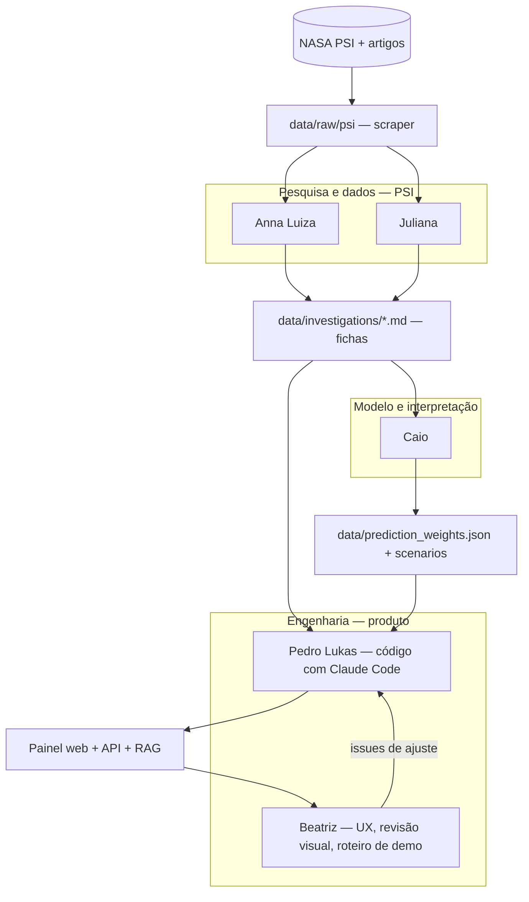

# Divisão de tarefas — Equipe Flame in Freefall

**Produto:** Space Firefighters  
**Equipe:** Beatriz · Pedro Lukas · Anna Luiza · Caio · Juliana  

**Foco do desafio:** encontrar, **comparar** e **interpretar** dados PSI para fire safety — com camada de **previsão orientada por evidência** (não “chute” de IA).

**Documentos irmãos:** [SPEC.md](./SPEC.md) (fonte de verdade técnica — prevalece em conflito) · [PLANO.md](./PLANO.md) (visão e conteúdo)

**Relógio:** H0 = sáb 14/11/2026 09:00 · code freeze dom 15/11 21:00 (H+36) · submissão até dom 15/11 23:59 (≈ H+39).

---

## 1. Como o time se encaixa (três frentes)

| Frente | Pessoas | Pergunta que respondem |
|--------|---------|-------------------------|
| **Pesquisa & curadoria** | Anna Luiza, Juliana | *Quais dados são vitais? O que difere entre investigações? O que significa para tripulação e Terra?* |
| **Modelo & previsão** | Caio | *Dado um cenário (O₂, pressão, material, 0g), quais experimentos se aplicam e qual risco/recomendação o PSI suporta?* |
| **Código & produto** | Pedro Lukas (código), Beatriz (UX/revisão) | *Como isso vira painel, comparador, chat e scenario builder utilizável no demo?* |

**Stack decidida** (detalhes no [SPEC §4](./SPEC.md#4-stack-decidida--não-trocar-sem-consultar)): Next.js full-stack + TypeScript na Vercel · Supabase pgvector · embeddings OpenAI · Claude Opus 5.5 para o chat com citações.

---

## 2. Papel de cada pessoa

### Anna Luiza — Curadoria PSI (prevenção, materiais, escala)

**Missão:** garantir que os experimentos **mais críticos para inflamabilidade e materiais** estejam bem documentados e comparáveis.

**Responsabilidades principais**

- Preencher fichas (`data/investigations/<slug>.md`, copiando `data/_template.md`) pelo GitHub web:
  - **BASS**, **SPICE**, **SLICE**, **BRE**, **CFI-G**, **SAFFIRE I–II–III** (stretch: **BASS-II**)
- Extrair **dados vitais** para previsão: % O₂, pressão, combustível/sólido, fluxo de ar, hardware (MSG/CIR/Cygnus) — **sempre com `evidence`** (de onde veio o número).
- Redigir em **inglês** a seção “**Why it matters for crew safety**” (3–5 bullets por investigação). Pode rascunhar em PT e traduzir.
- Preencher `data/reference_atmospheres.yaml` (Terra/ISS, habitat lunar, traje) **com fonte** — são as zonas do mapa O₂ × pressão.
- Escrever a nota de comparação **BASS × SAFFIRE** em `data/comparisons/`.
- Preencher `earth_applications` quando houver (materiais, EPI, SAFFIRE).

**Entregáveis**

| Prazo | Entrega |
|-------|---------|
| H+10 (sáb 19h) | BASS, SPICE, SLICE, BRE `complete` |
| H+16 (dom 01h) | CFI-G, SAFFIRE I–III `complete` + `reference_atmospheres.yaml` com fontes |
| H+20 (dom 05h) | Nota BASS × SAFFIRE + `expected_slugs` das perguntas de demo (com Juliana) |

---

### Juliana — Curadoria PSI (detecção, supressão, Terra)

**Missão:** cobrir **detecção/supressão** e a ponte **espaço → Terra** com evidência PSI.

**Responsabilidades principais**

- Fichas completas:
  - **SAME**, **SAME-R**, **FLEX**, **CFI** (stretch: **FLEX-2**, **DAFT**, PSI-115 se aplicável)
- Identificar **variáveis vitais** para detecção (tamanho de aerossol, duração de combustão, materiais de teste) e supressão (diluentes, pressão, gotículas).
- Redigir em **inglês** as seções **Earth impact** e os 4 cards de `data/spinoffs/` (detector fumaça/poeira, cilindros de ar, vestuário de bombeiros, névoa fina) — **conferindo as URLs Spinoff**.
- Notas de comparação **SAME × SAME-R** e **FLEX × CFI** em `data/comparisons/`.
- (P1) Mission context (Apollo/Mir/Artemis) + `timeline.yaml`.

**Entregáveis**

| Prazo | Entrega |
|-------|---------|
| H+10 (sáb 19h) | SAME, SAME-R, FLEX, CFI `complete` |
| H+18 (dom 03h) | 4 spinoffs com URLs conferidas + notas SAME×SAME-R e FLEX×CFI |
| H+28 (dom 13h) | `data/content/mission-context.md` + `timeline.yaml` (P1) |

---

### Caio — Modelo de previsão e cenários (evidência PSI)

**Missão:** dar **rumo ao modelo**: o que entra, o que sai, e como cada “previsão” cita investigações reais.

**Importante para o hackathon:** não treinar rede neural do zero. O MVP é **modelo híbrido**:

1. **Features estruturadas** vindas das fichas (curadoria).
2. **Score de similaridade / risco** (regras + pesos definidos com o time de pesquisa).
3. **Camada LLM** só para **explicar** o resultado com citações PSI (P1).

**Responsabilidades principais**

- Confirmar os vocabulários do [SPEC §6.3](./SPEC.md#63-vocabulários-controlados-datavocabyaml): `material_class` + `solid_form` (tecido = `solid` + `fabric`) e a lista de `prediction_tags`.
- Escrever `docs/MODELO-PREVISAO.md` seguindo o contrato do [SPEC §7](./SPEC.md#7-scenario-builder--contrato-portão-em-h20):
  - **Entradas:** `o2_percent`, `pressure_psi`, `gravity` (0g | 1g | partial_future), `material_class` (+ `solid_form`), `pillar`, `environment`.
  - **Saídas:** lista ranqueada de investigações, `risk_band` (low | medium | high | insufficient_data), `confidence`, `rationale_bullets[]`, `coverage_gaps[]`.
  - **Regras v1:** ex. O₂ acima do normal da Terra e sólido → priorizar BASS, CFI-G, SAFFIRE; detecção → SAME; supressão → FLEX.
- Definir `data/prediction_weights.json` (pesos ajustáveis; documentar suposições).
- Escrever `data/scenarios/expected.yaml`: **10 cenários de teste** (5 lunares, 3 ISS, 2 Terra) validados com Anna/Juliana — “academically defensible”.
- Preparar texto do **Scenario builder** para o pitch: *“não prevê fogo; prevê quais experimentos PSI melhor informam o risco”*.

**Entregáveis**

| Prazo | Entrega |
|-------|---------|
| H+8 (sáb 17h) | Vocabulários confirmados (PR em `data/vocab.yaml`) |
| H+20 (dom 05h) | `MODELO-PREVISAO.md` + `prediction_weights.json` + `scenarios/expected.yaml` → **portão de decisão** |
| H+31 (dom 16h) | (se passou no portão) validação cenário a cenário na UI; ajuste de pesos |

**Portão H+20** (no máximo H+24 se o time estiver dormindo): o Scenario vira P0 se houver modelo escrito, pesos não provisórios, ≥ 12 fichas `complete` e ≥ 7 de 10 cenários passando. Senão, vira slide do pitch.

---

### Beatriz — UX, revisão visual e demo

**Missão:** garantir que o painel **mostre** comparação e interpretação com visual forte para jurados — sem bloquear o código.

**Como trabalha:** o Claude Code (Pedro) constrói a UI a partir dos wireframes do [SPEC §10](./SPEC.md#10-frontend). Beatriz testa cada **preview da Vercel** e abre **issues no GitHub** com ajustes (visual, textos, fluxo, acessibilidade). Não depende de Figma.

**Responsabilidades principais**

- Revisar Home, Explore, Detalhe, Comparador, Earth e Ask a cada milestone.
- Validar tema escuro “cockpit”, legibilidade, contraste, celular básico.
- Escrever o **roteiro de cliques do vídeo** (alimenta o demo mode).
- Polimento final, vídeo e slides (com Pedro) após o code freeze.

**Entregáveis**

| Prazo | Entrega |
|-------|---------|
| Após M2 (~H+12) | Issues de ajuste do catálogo (Home/Explore/Detalhe) |
| Após M3/M4 (~H+18 / H+26) | Issues de ajuste do Ask, Comparador, Earth, mapa |
| H+30 (dom 15h) | `docs/DEMO-SCRIPT.md` (roteiro do vídeo) |
| H+36–39 | Vídeo + slides |

---

### Pedro Lukas — Engenharia (código com Claude Code, coordenação, RAG)

**Missão:** construir o produto inteiro com o Claude Code seguindo o [SPEC](./SPEC.md), integrar o conteúdo da curadoria e coordenar entregas e demo.

**Responsabilidades principais**

- Scaffold, schema das fichas (Zod), `data:build`, scraper PSI.
- Todas as páginas, API, mapa O₂ × pressão, comparador, Earth.
- **RAG / chat “Ask PSI”** (chunks + pgvector + Claude com citações; escopo tripulado, sem propelentes).
- Implementar o **endpoint de previsão** conforme o `MODELO-PREVISAO.md` do Caio.
- Deploy (Vercel + Supabase), env vars, CI, checklist Space Apps.
- Merge dos PRs de dados (dono do schema); sync a cada 4h.

**Entregáveis** (milestones do [SPEC §15](./SPEC.md#15-milestones-ordem-de-construção))

| Prazo | Entrega |
|-------|---------|
| H+4 (sáb 13h) | M0: repo, CI, deploy “hello”, Supabase |
| H+7 (sáb 16h) | M1: template de ficha, validação, scraper + `_index.json` para a curadoria |
| H+12 (sáb 21h) | M2: Home, Explore, Detalhe, export |
| H+18 (dom 03h) | M3: Ask PSI com citações |
| H+26 (dom 11h) | M4: Comparador, Earth, mapa O₂ × pressão |
| H+31–36 | M5/M6: Scenario (se passou) ou P1 + polimento; code freeze H+36 |

---

## 3. Lista conjunta: dados vitais (o que pesquisa precisa achar)

Tudo isso vai no frontmatter da ficha — o modelo e o comparador **não funcionam** sem esses campos. Formato completo no [SPEC §6.2](./SPEC.md#62-formato-da-ficha-data_templatemd).

| Campo | Por que é vital | Quem prioriza |
|-------|-----------------|---------------|
| `psi_id`, `experiment_name`, `psi_url` | Rastreabilidade, citação | Todos |
| `fire_safety_pillar` | Prevenção/detecção/supressão | Anna + Juliana |
| `material_class`, `solid_form`, `fuels` | Previsão de inflamabilidade | Anna |
| `atmosphere.o2_percent`, `atmosphere.pressure_psi` (+ `evidence`) | Mapa O₂ × pressão, cenário lunar | Anna + Caio |
| `atmosphere.flow_*`, `gravity` | Microgravidade vs solo | Anna + Juliana |
| `hardware`, `platform` | Comparador e narrativa | Anna + Juliana |
| `sensors`, `measured_variables` | Detecção / modelagem | Juliana |
| `variables_changed`, `variables_fixed` | **Comparar** investigações | Anna + Juliana |
| Seção “Why it matters for crew safety” | Texto para UI e RAG | Anna + Juliana |
| `earth_applications` + seção “Earth impact” | Valor na Terra | Juliana |
| `prediction_tags`, `lunar_relevance` | Entrada do modelo | Caio define, pesquisa preenche |

**Meta mínima:** 12 investigações herói `complete`; stretch 25+ (entram primeiro como `partial`, com selo no app).

**Regra de ouro:** número sem fonte não entra. Se não achar, deixe `null` — o app mostra “não informado”.

---

## 4. Fluxo de trabalho (handoffs)

| Ordem | Quem | Ação | Para quem |
|-------|------|------|-----------|
| 0 | Pedro Lukas | Scraper gera `data/raw/psi/_index.json` + texto bruto PSI | Curadoria |
| 1 | Anna + Juliana | Preenchem fichas `.md` pelo GitHub web (PR) | Pedro faz merge |
| 2 | Caio | Lê fichas, define tags/pesos, cenários | Pedro implementa na API |
| 3 | Pedro Lukas | `data:build` + `rag:ingest` + páginas | Preview Vercel |
| 4 | Beatriz | Revisa preview, abre issues de ajuste | Pedro |
| 5 | Caio + Anna + Juliana | Testam cenários e perguntas de demo na UI | Ajuste antes do pitch |
| 6 | Beatriz + Pedro Lukas | Vídeo e slides | Todos revisam fatos PSI |

**Contrato de arquivo:** uma ficha por PR (`data: add SAME`). O CI roda `data:build` e aponta em português o campo com erro. **Pedro Lukas** faz merge e é dono do schema.

**Template de ficha:** copiar `data/_template.md` para `data/investigations/<slug>.md`.

**“Ficha pronta”:** `data:build` verde · `curation_status: complete` · PSI-ID e URL conferidos · números com `evidence` · “Why it matters” com 3–5 bullets · Terra preenchida ou `null` justificado · revisada por outra curadora.

---

## 5. Cronograma por pessoa (hackathon)

Horas relativas (H0 = sáb 09:00).

| Hora | Anna Luiza | Juliana | Caio | Beatriz | Pedro Lukas |
|------|------------|---------|------|---------|-------------|
| 0–8h | Leitura PSI; BASS, SPICE | Leitura PSI; SAME, SAME-R | Vocabulários + esboço do modelo | Referências visuais; espera M2 | M0 scaffold + M1 dados/scraper |
| 8–16h | SLICE, BRE, CFI-G, SAFFIRE + atmosferas | FLEX, CFI + spinoffs | Pesos + 10 cenários | Revisão M2 (catálogo) | M2 catálogo + início M3 RAG |
| 16–24h | Nota BASS×SAFFIRE; demo questions | Notas de comparação; demo questions | **Portão H+20** | Revisão Ask | M3 Ask PSI; rag:warm |
| 24–31h | Stretch (`partial`) + QA fichas | Mission context (P1) | Validar cenários na UI | Revisão M4; roteiro demo | M4 comparador/Earth/mapa; M5 Scenario |
| 31–36h | QA científico pitch | QA spinoffs | Narrativa do modelo | Polish + roteiro final | M6 P1 + polimento; **freeze H+36** |
| 36–39h | Revisão de slides | Revisão de slides | Revisão de slides | Vídeo + slides | Vídeo técnico + submissão |

---

## 6. Modelo de previsão — visão para o pitch (Caio + Pedro Lukas)

**O que dizemos aos jurados**

> O painel **não substitui** simulação CFD nem teste de bancada. Ele **prevê qual conjunto de evidências PSI** melhor responde a um cenário habitável (O₂, pressão, material, gravidade) e classifica **risco relativo** com base em experimentos reais da ISS e correlatos.

**Três camadas (implementação MVP)**

1. **Matcher:** filtra investigações `complete` por tags e intervalos numéricos.
2. **Scorer:** soma pesos (`prediction_weights.json`) → `risk_band`.
3. **Explainer (P1):** Claude gera parágrafo com **PSI-IDs citados** (obrigatório); nunca altera o ranking.

**Exemplo de cenário demo (Lua)**

- Entrada: 32% O₂, 10 psi, `solid` + `fabric`, 0g, `lunar_habitat`.
- Saída esperada: alto vínculo BASS/SAFFIRE/CFI-G; `risk_band` conforme regras do Caio; recomendação de leitura ordenada; `coverage_gap` sobre gravidade parcial.

---

## 7. Rituais rápidos

- **Sync a cada 4h (15 min):** bloqueios, fichas novas, preview quebrou?
- **Canal fixo:** “Ficha pronta” = checklist da seção 4.
- **Dono do merge:** Pedro Lukas (schema e código); **donos do conteúdo:** Anna/Juliana aprovam texto científico; Caio aprova tags de previsão; Beatriz aprova visual.

---

## 8. Pitch e vídeo — quem fala o quê

| Trecho | Responsável |
|--------|-------------|
| Problema histórico (Apollo/Mir) | Juliana |
| Dados vitais e comparação BASS/SAFFIRE | Anna Luiza |
| Scenario / previsão com evidência PSI | Caio |
| Demo navegação + Earth | Beatriz |
| Fechamento impacto dual + stack NASA | Pedro Lukas |

---

## 9. Checklist antes de enviar

- [ ] 12+ fichas `complete` com dados vitais e fontes  
- [ ] 8+ com `earth_applications`  
- [ ] Comparador com 3 pares ensaiados (SAME/SAME-R, BASS/SAFFIRE, FLEX/CFI) com notas curadas  
- [ ] Mapa O₂ × pressão com zonas de referência com fonte  
- [ ] 8 perguntas de demo + 4 de controle passando no `rag:eval`  
- [ ] (se passou no portão) 10 cenários do Caio passando na UI com PSI-IDs visíveis  
- [ ] Vídeo com trilha espaço + trilha Terra  
- [ ] Checklist completo do [SPEC §17](./SPEC.md#17-checklist-de-aceite-da-demo-p0)

---

## 10. Ajustes flexíveis

- **Pedro Lukas** é o único que programa (com Claude Code); **Beatriz** é dona da UX e da demo, via issues e roteiro.
- Se Caio estiver atolado na validação, Anna ajuda em `prediction_tags`; Juliana valida cenários de detecção.
- Se a curadoria atrasar, as fichas entram como `partial` (aparecem com selo) e são completadas depois — nunca com números inventados.

---

*Atualizar este documento quando o time redistribuir fichas PSI ou após a decisão do portão H+20.*
